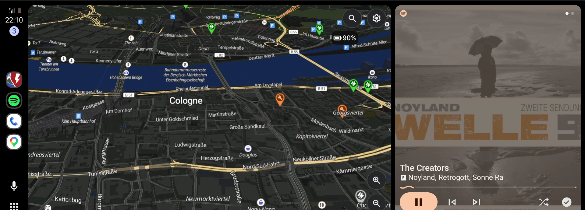

# nura-aa-proxy: a Linux phone as a wireless Android Auto dongle

A spare phone running **postmarketOS / Nura** (mainline Linux) plays the role
of a wireless Android Auto dongle for a car that only does wired Android
Auto, here a Hyundai Ioniq 5. The daily phone connects to it over Bluetooth
and 5 GHz Wi-Fi; the Linux phone sits on the car's USB port and looks like a
wired Android phone to the head unit.



*Android Auto from a Galaxy S25 FE, relayed wirelessly through the Linux
phone and shown by Google's Desktop Head Unit in the Ioniq 5 screen profile
(1920×720).*

The proxy itself is [aa-proxy-rs](https://github.com/aa-proxy/aa-proxy-rs).
This repository holds what it takes to run it on a postmarketOS phone instead
of a Raspberry Pi: the access point, firewall, systemd units, a desk-test
setup, and an OBD battery reader for EV routing in Google Maps.

> **Device:** currently runs on a Motorola Edge 30 Ultra with
> postmarketOS / Nura. Information about that port will follow in a future
> repository.

```
 daily phone ── Bluetooth (handshake: Wi-Fi credentials) ──┐
 (Galaxy S25)                                              ▼
             ── 5 GHz Wi-Fi "eqs-aa" (Android Auto data) ─► Linux phone ── USB (AOA accessory) ─► car head unit
                                                          ap0 10.0.0.1
                                                          aa-proxy-rs
```

## Status

| Part | State |
|---|---|
| Wireless Android Auto through the Linux phone | **works** (desk test with Desktop Head Unit over USB) |
| Recovery from dropouts | **works**, see [robustness](#robustness) |
| Ioniq 5 screen profile for the desk test | works; dpi/frame rate still to be read from the real car |
| First test in the car | to do |
| EV battery reader (vLinker MC+ OBD) | written, tested against an emulator only; byte positions need calibration in the car |
| Ioniq 5 energy model for Maps range | to do (aa-proxy-rs defaults to an F-150 Lightning model) |

## Requirements on the phone

- USB device-controller (gadget) mode with configfs **FunctionFS**
  (`CONFIG_USB_CONFIGFS_F_FS`). No `f_accessory` kernel patch: aa-proxy-rs
  does the Android Open Accessory handshake itself over FunctionFS.
- A Wi-Fi chip that can run an **access point next to the client interface**
  (`iw list`: `AP`, and a combination allowing managed + AP).
- Bluetooth with BlueZ, plus `hostapd`, `dnsmasq`, `iw`.

## Build aa-proxy-rs (on a PC)

```sh
rustup target add aarch64-unknown-linux-musl
pip install ziglang && cargo install cargo-zigbuild
git clone https://github.com/aa-proxy/aa-proxy-rs && cd aa-proxy-rs
cargo zigbuild --release --target aarch64-unknown-linux-musl \
    --no-default-features --features openssl/vendored
cp target/aarch64-unknown-linux-musl/release/aa-proxy-rs <this repo>/phone/
```

`--no-default-features` is required: the default `io-uring` feature disables
the USB path to the car. Tested with aa-proxy-rs 1.2.0 (git `f80236f`); the
result is a static binary.

## Install (on the phone)

```sh
rsync -a phone/ user@PHONE:aa-proxy-install/
ssh user@PHONE 'sudo apk add hostapd dnsmasq iw && sudo sh ~/aa-proxy-install/install.sh'
```

`install.sh` installs the binary, the configs and units, and creates
`/etc/aa-proxy-rs/config.toml` with a random Wi-Fi passphrase if there is
none. It starts nothing.

| File (`phone/`) | Purpose |
|---|---|
| `config.toml.in` | aa-proxy-rs config: `iface = "ap0"`, 5 GHz channel 36, country DE, web UI only on 10.0.0.1, MITM/EV off |
| `hostapd.conf.in`, `dnsmasq.conf.in` | templates aa-proxy-rs renders into `/run` (WPA2-CCMP only; DHCP only on `ap0`, no DNS) |
| `aa-proxy-ap0` | creates `ap0` next to `wlan0`, sets 10.0.0.1/24, turns Wi-Fi power save off |
| `60_aa-proxy.nft` | firewall drop-in: DHCP, 80 and 5288 accepted **only on `ap0`** |
| `systemd/aa-proxy.target` | "car mode" = ap0 + hostapd + dnsmasq + aa-proxy-rs |

## Use

```sh
sudo systemctl start aa-proxy.target    # car mode on
sudo systemctl stop aa-proxy.target     # off (reboot to get USB networking back)
```

On the daily phone, pair Bluetooth with **eqs-aa** once; from then on it
receives the Wi-Fi credentials automatically and reconnects by itself. Keep
the daily phone paired with the car's own Bluetooth as well: call audio goes
over the hands-free profile directly, not through Android Auto.

While car mode runs, aa-proxy-rs owns the USB port, so postmarketOS's USB
networking is gone; use SSH over Wi-Fi.

## Desk test: the PC plays the car

Google's Desktop Head Unit (DHU r2.1,
`https://dl.google.com/android/repository/desktop-head-unit-linux-x64_r02.1.zip`,
needs `libc++1 libc++abi1`) acts as the car over USB. Plug the Linux phone
into the PC, start car mode, then:

```sh
desk-test/dhu-loop.sh                       # starts DHU whenever the phone appears on USB
EDGE=user@<phone-ip> desk-test/aa-monitor.sh > run.csv    # temps, memory, Wi-Fi, data rates
EDGE=user@<phone-ip> desk-test/recovery.sh "proxy crash" \
    "ssh user@<phone-ip> 'sudo kill -9 \$(pgrep -x aa-proxy-rs)'"
```

`desk-test/dhu-ioniq5.ini` mimics the Ioniq 5's 1920×720 centre display:
Android Auto only streams 800×480, 1280×720 or 1920×1080, so wide screens use
1080p video with 360 px of margin.

### DPI

Lower DPI fits more map and more labels on screen at the cost of text size.
On the Ioniq 5's 12.3" screen at driving distance, **140** is a good balance
(130 shows more but shrinks the text, 160 is the readable default). The desk
head unit takes DPI straight from the `.ini`; **in the car, forcing a DPI
other than the one the head unit requests needs aa-proxy-rs MITM mode** (the
same certificates as EV routing), after which `dpi = 140` goes in the
aa-proxy-rs config.

**Pitfall:** DHU reads console commands from stdin and **exits silently
(code 0) on EOF**. Started in the background it quits right after its first
USB message, the PC resets the device, and it looks like a USB or protocol
bug. `dhu-loop.sh` gives it a FIFO as stdin.

## EV routing: battery data from OBD

`ev/ioniq5-bms.py` reads the Ioniq 5 battery management system (CAN 7E4,
UDS `22 0101` / `22 0105`) through an ELM327 adapter (vLinker MC+ over
Bluetooth RFCOMM) and posts the state of charge to aa-proxy-rs's `/battery`
endpoint. aa-proxy-rs starts it as `ev_battery_logger` when Android Auto asks
for EV data.

The byte positions of the state of charge are **not verified yet**. Calibrate
once in the car, with the charge level the car displays:

```sh
ev/ioniq5-bms.py --mac <vLinker address> --calibrate 72
```

Test without a car: `test/elm-emu.py 35000`, then
`ev/ioniq5-bms.py --tcp 127.0.0.1:35000 --calibrate 74` (synthetic data).

## MITM mode status (forced DPI + EV data)

Both forcing a DPI and feeding EV data to Maps need aa-proxy-rs **MITM mode**,
which needs the five Android Auto certificate/key files in `/etc/aa-proxy-rs/`
(`hu_cert.pem`, `hu_key.pem`, `md_cert.pem`, `md_key.pem`, `galroot_cert.pem`).
These are not in this repo; the aa-proxy-rs README links to places that
publish the known development set.

Tested so far against the desk Desktop Head Unit:

- **TLS handshake works** — the phone accepts `hu_cert`, the head-unit side
  accepts `md_cert`, on both the rustls and openssl backends.
- **But the stream stalls** — with `mitm = true`, each session runs ~10 s
  (the `timeout_secs` stall detector) then reconnect-loops. The A/V doesn't
  flow through the MITM path.

Unresolved. It may be a limitation of the DHU *emulator* rather than a real
head unit, so the next attempt belongs in the car. Levers to try there, in
order: start MITM as-is; set `add_vendor_channel = false`; enable
`pkt_debug` to see which channel stalls at ~10 s; try a non-expired
certificate set (the common `md_cert` expired in 2022). `overlay_enabled` and
`map_album_art_enabled` are already off by default, so they are not the cause.

## Robustness

Desk test, Galaxy S25 FE, DHU over USB. Every fault recovered without
touching the daily phone:

| Fault | Android Auto back after |
|---|---|
| head unit gone (infotainment reboot) | 7.7 s |
| aa-proxy-rs restarted | 9.2 s |
| aa-proxy-rs crashed (`kill -9`, systemd restarts it) | 14.7 s |
| access point restarted | 9.3 s |
| daily phone Bluetooth off for 10 s | 17 s after the drop |
| daily phone Wi-Fi off for ~10 s | 26 s after the drop |
| USB cable pulled for 5 s | 30 s after the pull (the phone waits ~17 s before a new session) |
| incoming call | session kept running, call shown in Android Auto |

During continuous use with navigation and music: proxy CPU about 6 %, memory
steady around 77 MB, phone at 34 °C while charging, daily phone's Wi-Fi at
−40 to −50 dBm and 104–156 Mbit/s, 0 % packet loss, average latency 18 ms.

## Pitfalls found on postmarketOS

- The default nftables policy drops DHCP and port 5288 on new interfaces such
  as `ap0`. Symptom: the daily phone gets the credentials over Bluetooth,
  joins the access point, gets no IP address, reports "cannot connect" after
  ~36 s, and asks for the Wi-Fi password. Fixed by `phone/60_aa-proxy.nft`.
- `sshd` has `AllowTcpForwarding no`, so `ssh -L` tunnels don't work; relay
  through `ssh user@PHONE nc 127.0.0.1 PORT` if needed.
- Wi-Fi power save drops SSH while the screen is off; `aa-proxy-ap0` turns it
  off for `wlan0`.
